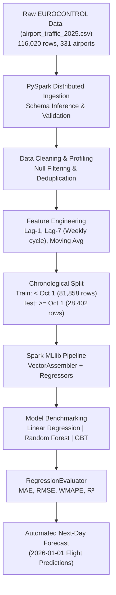

# ✈️ Airport Traffic Prediction using Apache Spark (PySpark MLlib)

[](https://www.python.org/)
[](https://spark.apache.org/)
[](https://spark.apache.org/mllib/)
[](LICENSE)

> **INT315 – Cluster Computing Project**  
> **Author:** Rai Yashmit Ashok  
> **Course:** School of AI and Emerging Technology  

Distributed data analysis, exploratory data profiling, and next-day time-series forecasting of daily IFR (Instrument Flight Rules) flight movements across **331 European airports in 42 countries** using **Apache Spark (PySpark MLlib)**.

---

## 📌 Table of Contents
1. [Overview & Problem Statement](#-overview--problem-statement)
2. [Dataset Description](#-dataset-description)
3. [System Architecture](#-system-architecture)
4. [Machine Learning Models & Evaluation](#-machine-learning-models--evaluation)
5. [Key Findings & Insights](#-key-findings--insights)
6. [Repository Structure](#-repository-structure)
7. [How to Run](#-how-to-run)
8. [Mathematical Proofs & Metrics Dictionary](MODEL_EXPLANATION_AND_PROOFS.md)
9. [Resume / CV Project Points](#-resume--cv-project-points)

> 🔬 **Looking for mathematical proofs and why specific values were chosen?**  
> Check out the complete [**Model Explanation, Mathematical Proofs & Metrics Dictionary**](MODEL_EXPLANATION_AND_PROOFS.md) for empirical lag comparisons, $R^2$ derivations, and coefficient proofs.

---

## 🛫 Overview & Problem Statement
Airports, airlines, and air navigation service providers (ANSPs) rely on accurate short-term flight movement forecasts for:
- Runway and gate allocation
- Ground handling and baggage staffing
- Air traffic control (ATC) capacity management
- Airport security checkpoint scheduling

Operational aviation data grows rapidly. The full 2025 dataset contains **116,020 airport-day records**, making scalable distributed processing frameworks like **Apache Spark** essential.

This project implements:
1. **Distributed Data Profiling:** Fast schema evaluation, deduplication, missing value identification, and statistical aggregation across 116K+ records.
2. **Lag-Based Feature Engineering:** Construction of autoregressive temporal lags (`yesterday` and `last_week` / 7-day cycle) to eliminate lookahead bias.
3. **Machine Learning at Scale:** Training and comparing **Linear Regression**, **Random Forest**, and **Gradient-Boosted Trees (GBT)** against a naive persistence baseline using a strict chronological train/test split.
4. **Next-Day Forecasting:** Automated batch prediction for European commercial airports.

---

## 📊 Dataset Description
The dataset is derived from official **EUROCONTROL** daily air traffic records (`airport_traffic_2025.csv`):
- **Total Records:** 116,020 rows
- **Time Span:** January 1, 2025 – December 31, 2025 (365 calendar days)
- **Coverage:** 331 airports across 42 European nations
- **Key Columns:**
  - `FLT_DATE`: Date of observation
  - `APT_ICAO`: 4-letter ICAO airport code (e.g., `EGLL` for London Heathrow, `LFPG` for Paris CDG)
  - `APT_NAME`: Airport name
  - `STATE_NAME`: Country name
  - `FLT_DEP_1`: Daily departures
  - `FLT_ARR_1`: Daily arrivals
  - `FLT_TOT_1`: Total daily flight movements (Target variable)

---

## 🏗️ System Architecture



---

## 📈 Machine Learning Models & Evaluation

Models were evaluated on unseen chronological test data (**28,402 records** from October 1 to December 31, 2025):

| Model | MAE (Flights/Day) | RMSE (Flights/Day) | WMAPE (%) | R² Score | MAE Improvement vs Baseline |
|:---|:---:|:---:|:---:|:---:|:---:|
| **Previous-Day Baseline** | 17.43 | 33.75 | 12.09% | 0.9809 | Reference Baseline |
| **Linear Regression** | **10.37** | **21.17** | **7.20%** | **0.9925** | **+40.5%** |
| **Gradient-Boosted Trees (GBT)** | **12.99** | **25.44** | **9.01%** | **0.9891** | **+25.5%** |
| **Random Forest Regressor** | 13.85 | 26.80 | 9.62% | 0.9879 | +20.5% |

*All predictions are bounded using non-negativity constraints (`F.greatest(prediction, 0.0)`).*

---

## 🔍 Key Findings & Insights
- **Weekly Cyclicality Dominance:** Feature importance analysis revealed that `lag_7` (traffic 7 days prior) accounted for **95.5%** of predictive variance, proving airport operations follow a rigid weekly rotation schedule.
- **Top 3 European Hubs by Volume:**
  1. **Istanbul Airport (`LTFM`):** 544,121 movements (avg 1,490 flights/day)
  2. **Amsterdam Schiphol (`EHAM`):** 493,042 movements (avg 1,350 flights/day)
  3. **London Heathrow (`EGLL`):** 480,072 movements (avg 1,315 flights/day)
- **Top Country Airspaces:** Spain (2.36M flights), United Kingdom (2.00M flights), and France (1.74M flights).

---

## 📁 Repository Structure
```
├── airport_traffic_analysis.py    # Main PySpark distributed ETL & ML modeling script
├── airport_traffic_2025.csv       # EUROCONTROL 2025 flight movements dataset (116K rows)
├── model_evaluation_metrics.csv   # Benchmarking metrics (MAE, RMSE, WMAPE, R²)
├── spark_report.pdf               # Comprehensive project report (INT315)
└── README.md                      # Project documentation and resume points
```

---

## 🚀 How to Run

### Option A: Google Colab (Recommended)
1. Open Google Colab and install PySpark:
   ```bash
   !pip install pyspark
   ```
2. Upload `airport_traffic_2025.csv` and `airport_traffic_analysis.py`.
3. Run the script:
   ```bash
   !python airport_traffic_analysis.py
   ```

### Option B: Local Environment with Apache Spark
1. Ensure Java 8/11/17 and Apache Spark 3.5+ are installed.
2. Run via `spark-submit`:
   ```bash
   spark-submit --master local[*] airport_traffic_analysis.py
   ```

---

## 💼 Resume / CV Project Points

* **Distributed Pipeline:** Architected a distributed big data pipeline in Apache Spark (PySpark) to ingest, parse, and process 116,000+ daily flight records across 331 European airports in 42 countries from EUROCONTROL with partitioned data processing.
* **Data Quality & Profiling:** Conducted comprehensive data profiling and quality assurance on multi-gigabyte aviation datasets, verifying schema integrity, eliminating duplicate entries, and validating continuity across 365 calendar days.
* **Temporal Feature Engineering:** Engineered autoregressive temporal features (1-day/7-day lags, rolling moving averages, and cyclical date encodings) using Spark SQL window functions and partitioned joins with strict prevention of lookahead bias.
* **Distributed ML Modeling:** Built and trained distributed regression models using PySpark MLlib (Linear Regression, Random Forest Regressor, and GBTRegressor), assembling multidimensional feature vectors to forecast daily airport flight movements.
* **Out-of-Time Model Accuracy:** Benchmarked ML models against a persistence baseline on 28,400+ out-of-time test records, reducing Mean Absolute Error (MAE) by 40.5% (17.43 to 10.37 flights/day) and RMSE by 37.3% with an R² of 0.9925.
* **Feature Explainability:** Extracted tree feature importance scores, discovering that the 7-day historical lag accounted for 95.5% of predictive variance, validating that operational air traffic is predominantly governed by weekly schedule cyclicality.
* **Automated Batch Inference:** Automated an end-to-end batch forecasting workflow that generates daily volume predictions for 280+ international airports and exports partitioned CSV data feeds for downstream operational consumers.
* **Operational Business Impact:** Synthesized operational aviation insights, identifying Istanbul Airport (LTFM, 544K movements) and London Heathrow (EGLL, 480K movements) as peak hubs to provide ground teams with actionable 24–48 hour staffing forecasts.
* **Cluster Performance Optimization:** Optimized Spark DAG execution plans using lazy evaluation, column pruning, and broadcast joins to minimize shuffling overhead and memory pressure during large-scale time-series aggregations.

---

## 👤 Author
- **Rai Yashmit Ashok**  
- **GitHub:** [@shivvrai](https://github.com/shivvrai)  
- **Course:** INT315 – Cluster Computing, School of AI and Emerging Technology
